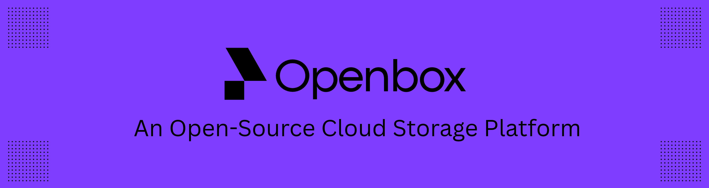

<p align="center">
  
</p>

<h1 align="center">Openbox - Cloud Storage Platform</h1>

<p align="center">
  A modern, open-source cloud storage platform to upload, organize, and access your files from anywhere.
</p>

<p align="center">
  
  
  
  
  
  
  
</p>

> 🚧 **Project Status:** Openbox is currently under active development. Features, APIs, and the database schema may change, and some parts described below are not implemented yet.

---

## 📖 About

**Openbox** is a full-stack, open-source cloud storage platform built with the **PERN stack** (PostgreSQL, Express, React, Node.js) and hosted on **NeonDB**, a serverless Postgres database. It lets users securely store, manage, and share files through a clean web interface.

## 💾 Storage

Because Openbox is open source, every user gets **1 GB of free storage** during the initial years of the project. Storage plans may change in the future as the platform grows.

## ✨ Features

Openbox is a work in progress. Here is where things stand:

- [ ] 🔐 User authentication (signup / login)
- [ ] 📤 File upload and download
- [ ] 📁 Folder creation and organization
- [ ] 🔗 File sharing
- [ ] 🗑️ Delete and manage files
- [ ] 🔍 Search through your files
- [ ] 💾 1 GB storage per user
- [ ] 📱 Responsive UI

## 🛠️ Tech Stack

| Layer      | Technology                    |
| ---------- | ----------------------------- |
| Frontend   | React                         |
| Backend    | Node.js, Express.js           |
| Database   | PostgreSQL (NeonDB)           |
| Auth       | JWT                           |

## 📂 Project Structure

```
openbox/
├── assets/              # Banner and images
├── client/              # React frontend (Vite)
│   ├── public/
│   ├── src/
│   │   ├── assets/
│   │   ├── components/
│   │   ├── hooks/
│   │   ├── pages/
│   │   ├── App.jsx
│   │   ├── index.css
│   │   └── main.jsx
│   ├── .env.example
│   ├── .gitignore
│   ├── .oxlintrc.json
│   ├── index.html
│   ├── package.json
│   ├── package-lock.json
│   ├── README.md
│   └── vite.config.js
├── docs/                # Project documentation
├── server/              # Express backend
│   ├── app/
│   ├── config/
│   ├── controllers/
│   ├── middleware/
│   ├── routes/
│   ├── services/
│   ├── utils/
│   ├── .env.example
│   ├── .gitignore
│   ├── index.js
│   ├── package.json
│   └── package-lock.json
├── .gitignore
├── package.json
└── README.md
```

## 🚀 Getting Started

### Prerequisites

- [Node.js](https://nodejs.org/) v18 or higher
- npm or yarn
- A [NeonDB](https://neon.tech/) account and project

### Installation

1. **Clone the repository**

   ```bash
   git clone https://github.com/rohangosavi26/openbox.git
   cd openbox
   ```

2. **Install dependencies**

   ```bash
   # Backend
   cd server
   npm install

   # Frontend
   cd ../client
   npm install
   ```

3. **Set up environment variables**

   Both `client/` and `server/` include a `.env.example` file. Copy it to `.env` in each folder and fill in your own values:

   ```bash
   # Backend
   cd server
   cp .env.example .env

   # Frontend
   cd ../client
   cp .env.example .env
   ```

   On Windows (Command Prompt), use `copy .env.example .env` instead of `cp`.

   Then edit each `.env` file:

   **`server/.env`**

   ```env
   PORT=5000
   DATABASE_URL=postgresql://<user>:<password>@<host>/<dbname>?sslmode=require
   JWT_SECRET=your_jwt_secret
   ```

   **`client/.env`**

   ```env
   VITE_API_URL=http://localhost:5000
   ```


4. **Run the app**

   ```bash
   # Start backend
   cd server
   npm run dev

   # Start frontend (in a new terminal)
   cd client
   npm run dev
   ```

5. Open `http://localhost:5173` in your browser.

## 🗄️ Database

Openbox uses **NeonDB** (serverless PostgreSQL). Copy your connection string from the Neon dashboard into `DATABASE_URL`.

## 📸 Screenshots

_Coming soon, screenshots will be added once the UI is ready._

## 🗺️ Roadmap

- [ ] Core MVP (auth, upload, download, folders)
- [ ] 1 GB storage quota per user (free during the initial years)
- [ ] File previews
- [ ] Shareable links with expiry
- [ ] Trash / recovery

## 🤝 Contributing

Contributions are welcome! Openbox is under active development, so please open an issue to discuss any big change before you start working on it.

1. Fork the repository
2. Clone your fork and create a feature branch from `main`
   (`git checkout -b feature/your-feature`)
3. Make your changes and test them locally
4. Commit your changes (`git commit -m "Add your feature"`)
5. Push to your branch (`git push origin feature/your-feature`)
6. Open a Pull Request describing what you changed and why

### Guidelines

- Keep pull requests small and focused on one change.
- Never commit `.env` files or secrets. Use `.env.example` for new variables.
- Report bugs or suggest features by opening an issue.

## 📄 License

This project is licensed under the [MIT License](LICENSE).

## 👥 Authors

- **Rohan Gosavi** - [@rohangosavi26](https://github.com/rohangosavi26)